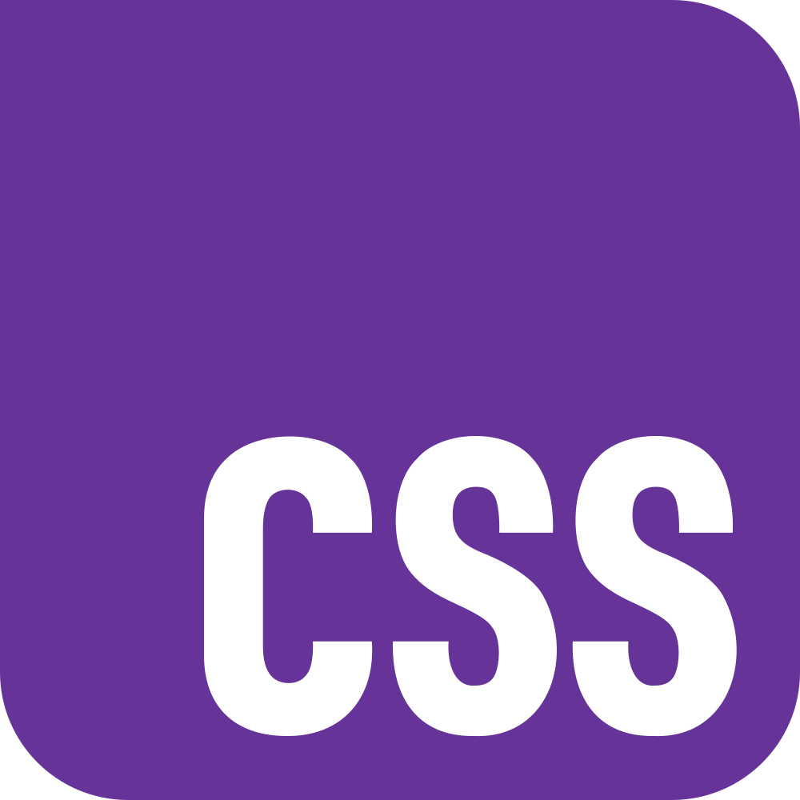

# 今月のフロントエンド

フロントエンド エンジニア集会 2026 年 11 月

---

## "今月のフロントエンド" とは

今月あったフロントエンドのニュースを, 以下のフォーマットで紹介します.

- ニュースがあった技術について, その名前かキーワード
- その技術に関する解説 (3 行目安)
- 何があったかを解説

---

## 取り上げないもの

- 特定フレームワークに関するバージョンアップ (例外あり)
- AI 単品のニュース

---

## iPhone Duo

2026/10/23

---

## "iPhone Duo" とは

- Apple の, 画面を折りたためる iPhone
- 閉じると外側の画面, 開くと内側の大きな画面を使う
- ブラウザは他の iPhone と同じく, WebKit エンジンの Safari

---

## iPhone Duo のニュース

**iPhone Duo の登場と同時に Safari 27.1 が公開された**

- 中身は **他の iPhone と同じ WebKit**. 専用の対応は基本的に不要
- ただし画面の幅は, 持ち方によって **382px 〜 951px** まで変わる
- Apple は「端末を判定せず, レスポンシブに作ること」を呼びかけている
- 実機がなくても, Xcode 27.1 のシミュレーターで確認できる

<!-- _footer: "出典: [WebKit Features for Safari 27.1 (WebKit)](https://webkit.org/blog/18486/webkit-features-for-safari-27-1/)" -->

---

## 持ち方ごとの画面幅

| 状態                         | 幅 (CSS px) |
| ---------------------------- | ----------- |
| 外側の画面, 縦持ち           | 382         |
| 外側の画面, 横持ち           | 594         |
| 内側の画面, 縦持ち           | 669         |
| 内側の画面, 横持ち           | **951**     |
| 内側の画面で 2 つ並べたとき  | 385 (各)    |

- 1 台で, スマホ幅からタブレット幅までを行き来する

<!-- _footer: "出典: [WebKit Features for Safari 27.1 (WebKit)](https://webkit.org/blog/18486/webkit-features-for-safari-27-1/)" -->

---

## 折り目を意識したレイアウト

Safari 27.1 では, 折りたたみ端末向けの API 2 つを **フラグ付きで試せる**

- **Device Posture API** — 半分折り曲げているかを判定する
- **Viewport Segments API** — 折り目の左右 (上下) それぞれの画面の大きさを取る

```css
@media (horizontal-viewport-segments: 2) {
  .wrapper {
    display: grid;
    grid-template-columns:
      env(viewport-segment-width 0 0) env(viewport-segment-width 1 0);
  }
}
```

---

## 他ブラウザとの互換性

| ブラウザ      | Device Posture API | Viewport Segments API |
| ------------- | ------------------ | --------------------- |
| Chrome / Edge | 132〜              | 138〜                 |
| Safari (iOS)  | 27.1〜 **フラグ付き** | 27.1〜 **フラグ付き** |
| Safari (Mac)  | ×                  | ×                     |
| Firefox       | ×                  | ×                     |

- 非対応ブラウザでは, メディアクエリに **一致しないだけ** で通常のレイアウトのまま
  → 後から足す使い方 (プログレッシブエンハンスメント) ができる

---

## Scroll-driven Animations

2026/10/27



---

## "Scroll-driven Animations" とは

- スクロール量に合わせて CSS アニメーションを進める仕組み
- `animation-timeline: scroll()` でスクロール位置に, `view()` で要素の見え具合に連動する
- これまでは JavaScript でスクロールを監視して実装するのが定番だった

---

## Scroll-driven Animations のニュース

**Firefox 159 が標準で有効にし, 主要ブラウザすべてで使えるようになった**

- 10/27 公開の Firefox 159 で, 設定なしで使えるようになった
- Chrome / Edge 115, Safari 26 に続く対応
  → 主要ブラウザで使える目印 **Baseline** に入った
- 2014 年の提案から, 12 年かけて全エンジンに揃った

<!-- _footer: "出典: [Firefox 159 release notes for developers (MDN)](https://developer.mozilla.org/en-US/docs/Mozilla/Firefox/Releases/159) / [New to the web platform in October (web.dev)](https://web.dev/blog/web-platform-10-2026)" -->

---

## 書き方の例 — 読了プログレスバー

```css
@keyframes grow {
  from { transform: scaleX(0); }
  to   { transform: scaleX(1); }
}

.progress {
  transform-origin: left;
  animation: grow linear;
  animation-timeline: scroll(); /* animation より後に書く */
}
```

- ページのスクロール量に合わせて, バーが左から伸びる
- `animation` の一括指定は `animation-timeline` を初期値に戻すため, 順番に注意

---

## 他ブラウザとの互換性

| ブラウザ      | `animation-timeline` |
| ------------- | -------------------- |
| Chrome / Edge | 115〜                |
| Safari        | 26〜                 |
| Firefox       | 159〜                |

- 非対応ブラウザでは `animation-timeline` が無視され,
  **スクロールと無関係な普通のアニメーション** として動いてしまう
- 古いブラウザも対象なら, `@supports (animation-timeline: scroll())` で囲むのが安全

---

## Node.js

2026/10/28


---

## "Node.js" とは

- サーバーサイドで JavaScript を実行するランタイム
- Chrome と同じ V8 エンジンで JavaScript を動かす
- フロントエンドのビルドツールや開発サーバーの土台としても欠かせない

---

## これまでの経緯

**2026/03, リリースの出し方を 10 年ぶりに変えると発表**

- これまで: 年 2 回メジャー版を出し, **偶数版だけが長期サポート (LTS)**
- これから: **年 1 回 (4 月)** に出し, **すべての版が LTS** になる
- 奇数版が担っていた「先行お試し」は, 新設の **Alpha 版** が引き継ぐ
- 新しい方式は **Node.js 27 から**. Node.js 26 は旧方式の最後の版

<!-- _footer: "出典: [Evolving the Node.js Release Schedule (Node.js)](https://nodejs.org/en/blog/announcements/evolving-the-nodejs-release-schedule)" -->

---

## Node.js のニュース

**Node.js 26 が LTS になり, 翌日に新方式で初の Node.js 27 Alpha 版が出た**

- 10/28: Node.js 26.13.0 で **LTS 入り**. 2029 年 4 月末までサポートされる
- 10/29: **Node.js 27.0.0-alpha.0.0.0** を公開. 新方式で最初のリリース
- Node.js 27 の正式版は 2027 年 4 月の予定

<!-- _footer: "出典: [Node.js 26.13.0 (LTS)](https://nodejs.org/en/blog/release/v26.13.0) / [Node.js 27.0.0-alpha.0.0.0 (Alpha)](https://nodejs.org/en/blog/release/v27.0.0-alpha.0.0.0)" -->

---

## Alpha 版とは何か

- 正式版の前に, **互換性を壊す変更も含めて** 先に試すための版
- 毎晩自動で作られる Nightly 版と違い, **署名付きで, テストを経て** 公開される
  (主要な OSS のテストを新しい Node.js で走らせ, 壊れないか確かめている)
- **本番利用は想定していない**
- Node.js は「ライブラリ作者は CI に Alpha 版を入れてほしい」と呼びかけている

<!-- _footer: "出典: [Evolving the Node.js Release Schedule (Node.js)](https://nodejs.org/en/blog/announcements/evolving-the-nodejs-release-schedule)" -->

---

## Node.js 27 Alpha の中身 (抜粋)

- V8 15.6 に更新. `Math.sumPrecise()` や `Iterator.zip()` などが標準で使える
- **npm 12** を同梱 (依存パッケージの install スクリプトを既定で実行しない版)
- Intel Mac のサポートが **experimental (試験的) に格下げ**

<!-- _footer: "出典: [Node.js 27.0.0-alpha.0.0.0 (Alpha)](https://nodejs.org/en/blog/release/v27.0.0-alpha.0.0.0) / [npm CHANGELOG (GitHub)](https://github.com/npm/cli/blob/latest/CHANGELOG.md)" -->

---

# おわり
